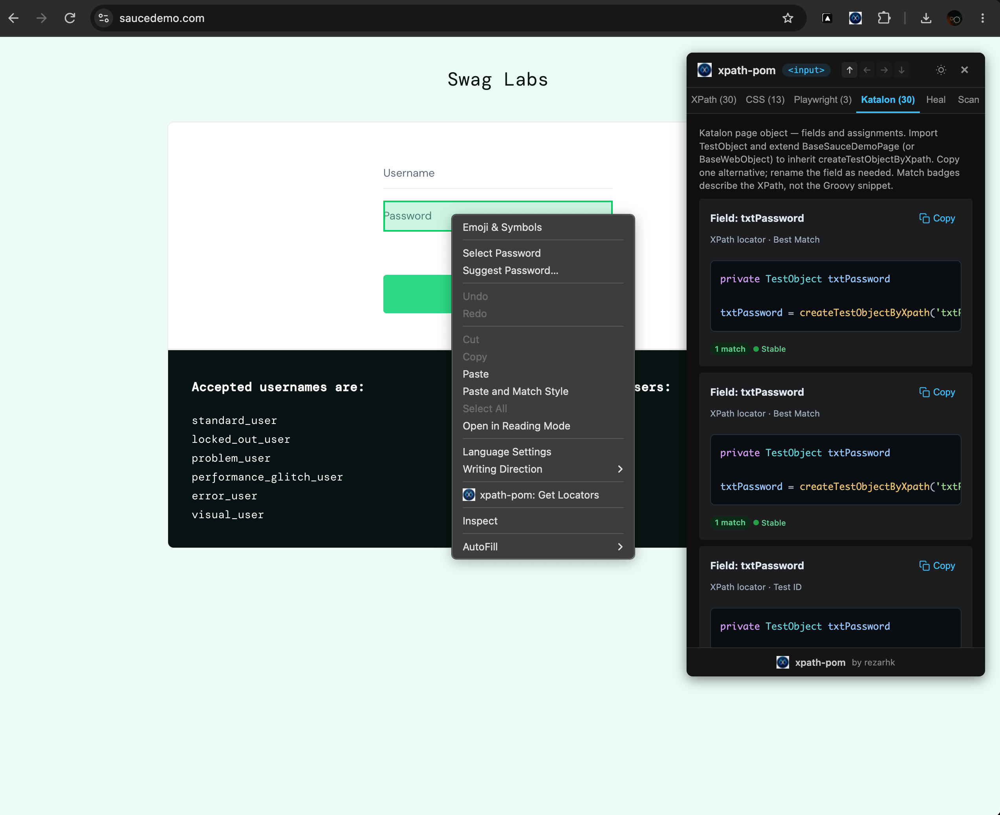

# xpath-pom

[](https://github.com/rezapace/xpath-pom/releases/latest)
[](https://github.com/rezapace/xpath-pom/releases)
[](https://github.com/rezapace/xpath-pom)

> **Download (production package):** [xpath-pom-v2.7.0.zip](https://github.com/rezapace/xpath-pom/releases/latest/download/xpath-pom-v2.7.0.zip) — unzip, then load the folder via `chrome://extensions` → *Load unpacked*.

Chrome Manifest V3 extension (version 2.7.0) for inspecting page elements and generating XPath, CSS, Playwright, and Katalon locators. It also provides a Generate POM workflow for exporting selected elements as a Katalon/Groovy page-object class. The extension injects its content script on demand; it does not declare host permissions.

## Demo



## Features

- Start and stop inspection with the toolbar button; hover/select page elements to view generated locator suggestions.
- Generate XPath and CSS selectors and Playwright locator expressions, with match-count and heuristic stability indicators.
- Copy locator text and evaluate XPath, CSS, or supported Playwright locator formats against the current page. Matches can be highlighted.
- Katalon tab shows `TestObject` declarations and `createTestObjectByXpath(...)` snippets, with copy support.
- Generate POM builds a Groovy page-object class from scanned elements, previews highlighted code, and supports copy/download.
- Context menu item **xpath-pom: Get Locators** opens locator results for a context-menu element.
- Inspector includes dark mode, element navigation, and a Scan tab. Shadow DOM traversal is supported for inspection/locator generation where implemented.

Stability values are heuristic recommendations, not guarantees that a locator remains valid as an application changes.

## Install / reload (Chrome)

1. Download or clone this repository and keep `manifest.json`, `background.js`, `content.js`, `content.css`, and `icons/` together.
2. Open `chrome://extensions` and enable **Developer mode**.
3. Choose **Load unpacked** and select this project directory.
4. After changing extension files, return to `chrome://extensions` and click the extension's **Reload** button. Reload the target page as needed so its content script uses the updated code.

The manifest uses the extension action, `activeTab`, `scripting`, `contextMenus`, and `alarms`; no build/install package or npm dependencies are provided in this repository.

## Use

1. Open an ordinary `http` or `https` page. Restricted browser pages (such as `chrome://` pages) cannot be scripted.
2. Click the toolbar icon to toggle inspection. Move over page content and select an element to open its locator panel. Alternatively, right-click an element and choose **xpath-pom: Get Locators**.
3. Choose XPath, CSS, Playwright, or Katalon tabs. Copy a locator/snippet using its copy button. Use the test input and **Evaluate** to check supported locator formats in the current DOM.
4. Use **Scan** to collect elements and **Generate POM** to preview/export a page-object class. The generated class uses project-specific conventions (for example `pageobjects.web.saucedemo`, `BaseSauceDemoPage`, and `createTestObjectByXpath`); it is a code template, not a standalone Katalon project. Review and adapt package, base class, and helper dependencies before using it.

Generated selectors describe the DOM at inspection time. Re-evaluate them against the application and prefer stable test/accessibility attributes where available.

## Tests

Tests use Node.js built-in modules and require no package installation. From the repository root run:

```sh
node tests/katalon.cjs
node tests/pom.cjs
node tests/runtime-invalidation.cjs
```

These scripts exercise Katalon snippet formatting/highlighting/copy, POM generation and escaping/preview/download, and extension-context invalidation/lifecycle behavior. They are focused regression tests; they do not run a browser integration suite.

## Project structure

```text
manifest.json                 Chrome MV3 manifest
background.js                 Extension service worker (bundled)
content.js                    Injected inspector, locator and export logic
content.css                   Inspector styles
icons/                        Toolbar and extension icons
 tests/
   katalon.cjs                 Katalon snippet tests
   pom.cjs                     POM generation tests
   runtime-invalidation.cjs    Lifecycle/runtime tests
```

`background.js` and `content.js` are shipped bundles; corresponding `.map` source maps are present. There is no source/build pipeline or dependency manifest in this repository.

## Known limitations

- This repository contains a Chrome extension, not a full Katalon project. POM output assumes Katalon classes/helpers and a project-specific base page class; generated code may need adaptation.
- POM generation deliberately skips elements outside the current document context, including iframe/frame and shadow-root elements, because the generated XPath/WebDriver page object cannot address those contexts as ordinary document locators.
- Shadow DOM/iframe support differs by operation: inspection can traverse open shadow roots, while cross-frame locator validation can be limited; generated POM locators are restricted as described above.
- Playwright output is generated as locator expressions, not as a complete test or Playwright project. The evaluator recognizes a subset of locator formats rather than executing Playwright itself.
- Match counts and stability scores reflect the current DOM and internal heuristics; they cannot establish future uniqueness or robustness.
- Browser-internal, protected, or otherwise non-scriptable pages are outside the extension's reach. No automated browser-level tests are included.
